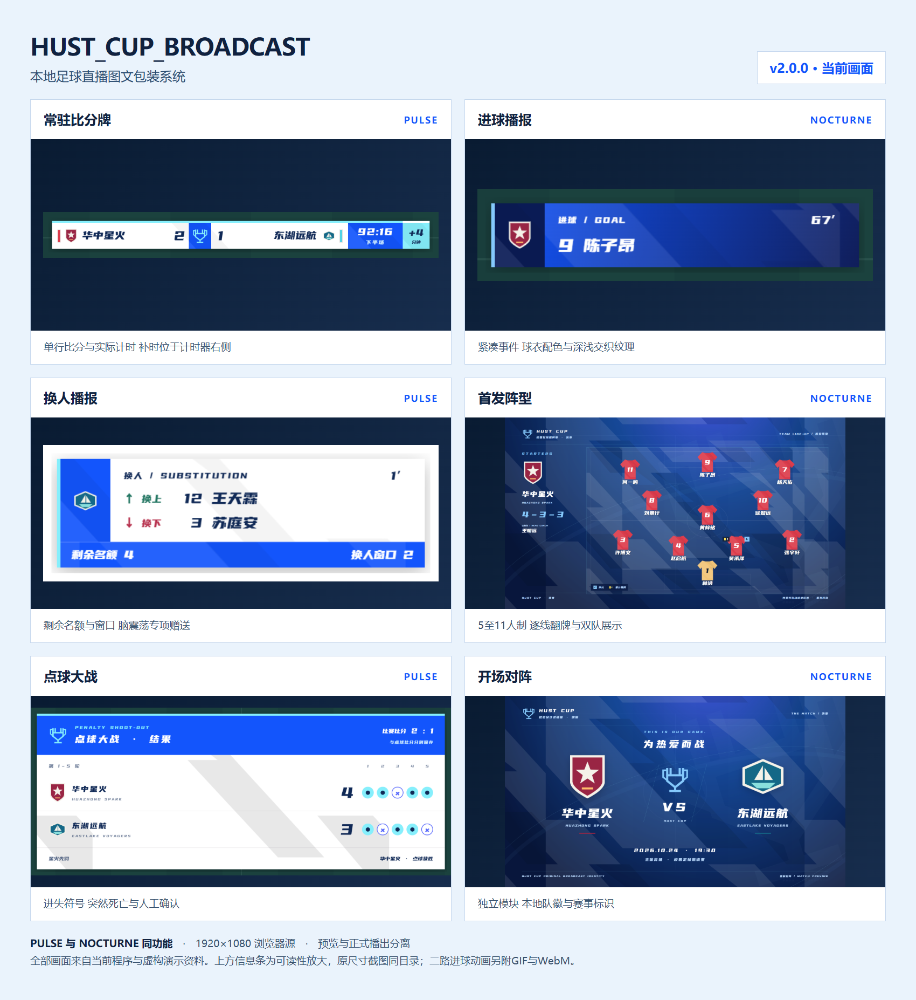

# HUST_CUP_BROADCAST

面向校园足球赛事的本地直播图文包装系统。中文单人操作后台，1920×1080透明OBS浏览器源，覆盖入场、首发、比赛事件、中场、加时点球和赛后。**当前版本 v2.0.0**，原作者 **Fantasticrap@GitHub**。



[项目介绍](docs/项目介绍.md) · [Word操作指南 v2.0.0](docs/操作指南/HUST_CUP_BROADCAST_使用者操作指南_v2.0.0.docx) · [在线操作说明](docs/操作指南/README.md) · [项目报告](docs/项目报告.md) · [v2.0.0源码](https://github.com/Fantasicrap/HUST_CUP_BROADCAST/tree/v2.0.0)

## 先启动 再接入 OBS

1. 安装Node.js 20或更新版本，将完整源码解压到固定文件夹。核心播出不需要npm install，不依赖网络字体或CDN。
2. 双击“启动系统.cmd”，看到READY后保持窗口打开；兼容入口“启动预览.cmd”保留。也可在项目目录执行 `node server.mjs`。
3. 后台打开 http://127.0.0.1:3210/ 。OBS添加浏览器源，填下面的合成地址，尺寸1920×1080，放在视频源上方。

```text
合成输出 http://127.0.0.1:3210/overlay.html?mode=live&transparent=1
常驻层   http://127.0.0.1:3210/overlay.html?mode=live&transparent=1&part=persistent
临时层   http://127.0.0.1:3210/overlay.html?mode=live&transparent=1&part=temporary
独立二路 http://127.0.0.1:3210/goal2.html
转场源   http://127.0.0.1:3210/transition.html
```

一般使用合成输出即可，无需再叠一份常驻层。打不开时先查看启动窗口与runtime/startup.log，详见[Windows启动说明](docs/Windows-startup.md)。

## 按整场比赛操作

1. **赛前资料**：新比赛先备份并确认新建，再填写人数制度、双方队名/队徽、赛事logo、本场球衣色、时长和赛事规则。
2. **阵容**：两队分别录入首发替补与阵型，核对后“将已编辑阵容同步到比赛”。照片和视频可选。
3. **画面与开播**：按需添加裁判、解说、赞助与通用人物，选择主题和模块；确认检查列表，发布资料，再播开场或首发。开场动画不会自动开表。
4. **赛中**：实际开球时应用相应阶段。事件入口 → 填写与球员检索 → 确认并预览 → 应用并播出；重播已有动画不会重复记账。
5. **中场与加时**：实际吹停后应用对应休息阶段，再处理换人和统计。切换导航或按暂停不等于进入中场。
6. **赛后**：明确停表，核对账本与结果，人工确认后播赛果，导出含素材项目包。

| 操作 | 会发生什么 |
|---|---|
| 同步名单 | 保存本场比赛名单与规则，用于检索和记账 |
| 发布资料（不换画面） | 发布草稿资料，不切换当前模块、不重播动画 |
| 预览此画面 | 只核对画面，不送入OBS、不记账 |
| 正式播出此画面 | 播出所选模块，忙时进入队列 |
| 结束包装，回到比分牌 | 清待播并结束包装，仅在比赛阶段显示左上 |
| 紧急清屏 | 立即清除两路包装与待播，不自动停表、不清比赛账本 |

## 当前功能

- **两套完整主题**：PULSE紧凑几何与NOCTURNE深蓝风格；蓝白五色、本地优设标题黑、球衣渐变、深浅纹理、方角/圆角。后台另有白天/黑夜模式。
- **紧凑比分与计时**：赛事logo位于双方队名中间，可与时间交换位置；实际累计秒级计时、右侧+n分钟补时、队伍事件扩展、上沿半露红牌。自定义时长、负校准和确认清零，到点不自动结束。
- **首发与阵型**：5/7/8/9/11人制，首发恰好N人且含1门将，替补最多16人；对应模板、自定义分线与拖动位置，照片/视频、队长和累计黄牌；逐线介绍与双方翻转衔接。
- **事件与纠错**：进球、取消进球、黄红牌、两黄变红、多人换人、点球及关联给牌、VAR和通知；球员按号码/姓名检索绑定，预览与实播分离，重播不重记。
- **完整比赛流程**：开场、入场、裁判/解说、替补、五类底部比分、半场/全场、统计、两回合总比分与人工确认结果。未知统计留空。
- **点球大战**：独立比分与逐脚记录，罚进/罚失/重罚、提前决胜、突然死亡、长轮次自动布局；底部进行中简版和赛后面板。
- **独立二路进球**：单独浏览器源及API，只播动画不加分；球队球衣色、GOAL闪动、原字体斜体姓名、足球入网停球。
- **本地保存与播控**：优先级队列、完整收起动画、紧急清屏、统一输出延迟、快捷键、导入导出含引用素材、断线重连与重启恢复。

## v2.0.0 换人名额与窗口

新项目默认每队 **5个普通名额、3个普通窗口**；赛前可改或关闭普通限制，脑震荡政策默认关闭。旧存档保留原无限制制度。

多人同批换人按人数扣名额、共用一个窗口；一批一次确认，整批记账后逐组展示。中场、加时前休息和加时中场扣名额免窗口，普通暂停不免。仅同一实际暂停分批录入才可明确沿用上个窗口。

启用政策后，每队最多1次永久脑震荡换人，不扣普通额度，对方获1个专项名额与窗口。受赠方选“对方脑震荡赠送换人”使用；未实际赠送时不显示括号。左下示例“剩余名额3（+1）”表示3个普通另加1个专项，使用后分别减少。

[规则与操作示例](docs/v2.0.0换人名额与窗口.md) · [默认设置](design-previews/v2.0.0/default-settings.png) · [PULSE换人条](design-previews/v2.0.0/footer-pulse.png) · [NOCTURNE换人条](design-previews/v2.0.0/footer-nocturne.png)

## 升级与保存

先导出比赛并备份runtime，再择时停止旧服务、更新程序、重启并刷新后台及OBS源。重启后按提示核对暂停计时、阶段与离线时间，不能靠刷新页面加载服务端更新。不要删除runtime比赛数据或仍在使用的锁。

程序保留v1.9.0旧版标签，当前完整更新为v2.0.0。旧指南仅供对应版本参考；新操作统一看v2.0.0指南。[历史变更](CHANGELOG.md)与docs中的各版说明仍保留。

## 可选功能与边界

赛前[本地人像抠图](docs/赛前人像抠图.md)另需Python环境与模型，核心播出不依赖它。视频录制、回放与推流由OBS负责，系统转场只提供图形遮挡。二路接口不代替视频推流。积分榜、其他场次与下场预告为后续扩展。

动画目标为1080p/60fps，实际OBS性能须用目标设备测试。[1080p关键原图](design-previews/v2.0.0)供核对布局；[历史GIF](design-previews/v1.8.4/goal2-loop.gif)是960×540分享预览，当前二路姓名样式以v2.0.0实际输出为准。

## 开发与验证

```text
npm test
npm run check
npm run review
npm run review:substitutions
```

当前程序74项Node测试、8套57组浏览器回归通过，使用隔离比赛，不操作正式runtime。浏览器回归需开发依赖Playwright与本机Edge，证据默认写work，可重新生成；正常运行不需要这些开发依赖。详见[验收摘要](docs/验收/v2.0.0.json)。

## 开源与署名

原创代码采用标准[MIT许可](LICENSE)，再发布时保留Fantasticrap@GitHub版权和许可文本；第三方字体/素材沿用原许可，见[AUTHORS](AUTHORS.md)和[字体说明](public/fonts/YouSheBiaoTiHei-NOTICE.md)。后台可在系统设置关闭本浏览器署名，主路、二路和转场不加可见像素水印。
