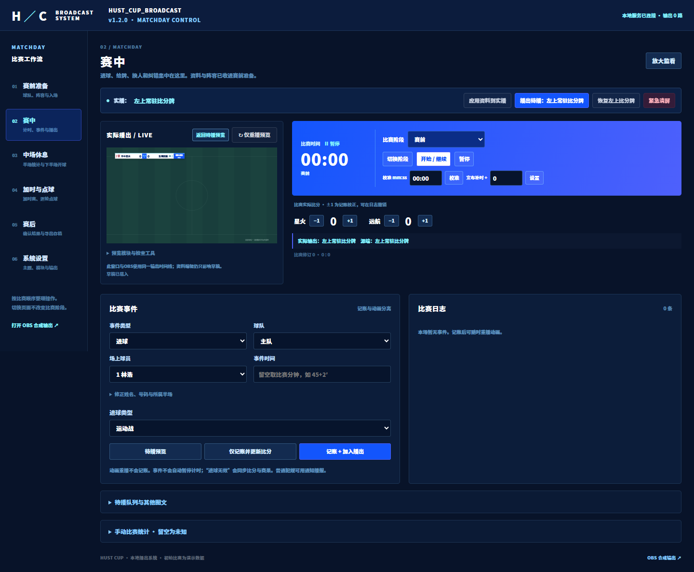

# HUST_CUP_BROADCAST

本地足球直播图文包装系统，1920×1080 透明 OBS 浏览器源，中文单人操作后台。PULSE 使用紧凑几何色块，NOCTURNE 使用深蓝渐变与光弧，两套主题共享比赛数据、功能和播出流程。

v1.1 主题色：#85C9FC、#86EFFC、#4E60FC、#1355FC、纯白。默认本地 Noto Sans CJK SC Black 粗黑字体，经用户选择作为参考图的接近方案，支持上传授权字体。


## v1.5.0 方圆角与分段动画

系统设置 → 视觉主题与边角，可选择方角或圆角，后台立即变化；点击“更新直播资料”后才进入 OBS。两主题共用此配置，导入导出保留；比分牌红牌不会被圆角裁掉。

对称包装改为主体从中间向左右展开330ms → 保持330ms → 上下延伸440ms；收起先收扩展300ms → 保持300ms → 左右回中心300ms。紧急清屏仍立即执行。

新增[渐变亚克力材质提案](http://127.0.0.1:3210/material-preview.html)，可比较实色与亮面材质、两主题、方/圆角，支持完整画面和细节近看。按用户最新确认，背景最多透出30%底图（底色至少70%，默认75%），并提供0–30%滑杆；新材质仅预览，未应用到实播。入口位于系统设置，效果见[材质对比图](design-previews/v1.5.0/acrylic-detail-comparison.png)。

45项Node测试、22项动画检查、7组边角/材质检查及既有35组浏览器回归通过。升级需保留runtime并重启服务后刷新后台/OBS，计时按原恢复机制暂停核对。详见[边角与材质说明](docs/v1.5边角与材质说明.md)。

## v1.4.2 动态收拢与日志清理

所有展开类包装增加完整收拢动画；提前撤下和切换也会完成退场，紧急清屏仍立即清空。手动改比分明确显示“当前→修改后”，预览不写入，应用才改变实际比分且不新增进球者。比赛日志新增一次确认的“清理日志”，收起列表并保留比赛数据，可查看历史日志。

43项Node测试与新增7组浏览器流程检查通过。更新后重启服务并刷新后台/OBS浏览器源，保留runtime。

## v1.4.1 事件弹窗与包装升级

v1.4.1补齐v1.4.0发布时漏入Git提交的服务端变更，源码与下载包一致；旧版均保留。

赛中点击事件名称 → 弹窗填写 → 确认并预览 → 应用并播出。点球支持同时给牌，左下点球、左上受罚球员；进球无效在左上显示原因。VAR有方框字标与六类决定；输出特殊进球统一(OG)/(P)。

加入12人替补布局、10种阵型、四类球队官员、更大球员媒体和赛事开场；裁判/解说分开并支持学院与长姓名；赞助logo可上传并放大。底部统一中心展开再向上，半场与下半场开场数据一致；左上仅比赛阶段持续显示。

升级需停止旧服务、保留runtime后重新启动，再刷新后台/OBS浏览器源。重启计时保持暂停，核对后点“应用”继续。用法见[后台工作流](docs/后台工作流.md)，完整边界见[项目报告](docs/项目报告.md)。

## v1.3.1 特殊进球类型与乌龙球归属

“特殊进球类型”默认无（普通进球），普通进球不显示特殊标记；只有点球、乌龙球标注。乌龙球选择球员所属队，给对方加分，播报及进球记录仍归乌龙方。例如主队乌龙，客队+1，主队侧显示该球员及乌龙标记。取消和纠错同步比分、半场/全场记录与总比分，旧存档兼容保留原比分。34项Node测试和11组新增浏览器检查通过。

此版更新服务端比赛逻辑，升级须重启服务后刷新后台，保留runtime；操作说明及完整报告见docs目录。

## v1.3.0 计时与播出操作

顶栏直接选择画面 → 仅预览 / 播出所选画面。更新直播资料保持原画面及动画进度；只显示左上比分牌会结束其他包装并清空队列，保留已发布资料。按钮下方提供区别说明。

赛中球员、换下和换上均支持按号码/姓名搜索，选择后绑定姓名与号码，候选跟随当前场上/替补名单。

计时合并为“应用”：阶段没改就继续，阶段改变才切换起点，休息/结束阶段暂停。新增一次确认的计时清零，以及 `-00:10` / `+00:10` 增减校准和±10秒按钮。30项Node测试、18组新浏览器检查通过。

**升级v1.3需要重启本地服务后刷新后台**，因为计时和切回常驻新增了服务端接口。保留原runtime目录，不要导入演示覆盖比赛；重启后计时保持暂停，确认状态后继续。完整用法见 [后台工作流](docs/后台工作流.md)。

## v1.2.0 按比赛时间整理后台

默认打开 **赛中**：实播监看、计时、实际比分 ±1、事件与日志。队伍名称、名单和素材移到 **赛前准备**；半场、点球、赛果和系统设置各有独立分类。队列、统计及预览工具按需展开，监看可放大。切换分类不会改变比赛阶段、计时或实际播出。

详细位置与操作见 [后台工作流](docs/后台工作流.md)。26项现有测试、19组工作流浏览器检查通过；以临时比赛验证，不改正在运行的比赛。刷新后台即可加载新界面，OBS 输出地址不变。



## v1.1.2 实播监看

明确播出后自动切到实际输出，顶部可返回待播预览；日志显示正在实播、排队、延迟和撤销状态。客队进球及主客连续事件通过5组浏览器复测。编辑仍先入草稿，重播不重复加分。刷新后台加载本次前端修订即可。

## v1.1.1 修正

红牌位于该队计分板上沿，只露半张（13/26px），最多4张。事件分钟按阶段与自定义时长取当前分钟，例如上半场45:21为45+1′，下半场45:21为46′；40分钟半场的41:00为40+2′。宣布+2不限制实际补时，90+4′仍可记录。计时运行时拦截全场画面和待播全场条，须操作员先停止计时后手动播出。26项测试通过。

## v1.1 比分牌修订

补时只在计时器右侧显示 +n 分钟，主计时器始终显示实际累计时间（如92:16），超过宣布时长仍继续。比分牌下方仅在进球、黄牌、红牌正式播出时，在发生事件的球队下方展开，结束后收起；总比分/点球附加信息改放顶部辅助标签。

队徽上红牌默认自动跟随场上被罚下人数，最多4张；球队资料内可 +1/-1/恢复自动校正显示，均先入草稿并需应用，不改变实际处罚账本。替补和教练被罚不增加自动标记。下方事件扩展、队徽红牌可分别关闭。

本次25项测试通过，新增6组实际浏览器验证，截图见 design-previews/v1.1/。

## 启动与 OBS

需要 Node.js 20+。正常运行不需要 npm 安装，不依赖网络字体或 CDN。

1. 完整解压发布包；双击「启动系统.cmd」（旧名「启动预览.cmd」也保留）。
2. 等待出现 [READY]，保持窗口打开。
3. 后台：http://127.0.0.1:3210/。
4. OBS 添加浏览器源，填写下方合成输出，宽 1920、高 1080、目标 60fps。

```text
合成输出 http://127.0.0.1:3210/overlay.html?mode=live&transparent=1
常驻层   http://127.0.0.1:3210/overlay.html?mode=live&transparent=1&part=persistent
临时层   http://127.0.0.1:3210/overlay.html?mode=live&transparent=1&part=temporary
转场源   http://127.0.0.1:3210/transition.html
```

透明输出不含预览球场底图。分层源共用时间线，大画面与底部面板会避让常驻层。一般直接使用合成输出。端口、Node 和手动启动见 [Windows 启动说明](docs/Windows-startup.md)。

## 操作要点

- 资料编辑、主题选择和左侧预览仅修改草稿；正式播出/应用资料才更新 OBS。
- 新比赛先编辑球队、首发、替补和素材，再新建空白比赛或同步阵容。
- 先切换比赛阶段，再开始计时；到时不自动结束，补时宣布值和实际时间分别显示。
- 事件可只记账或记账加播出；重播动画不记账。日志支持撤销、恢复和纠错。
- 多人换人更新当前名单，原始首发保留；两黄自动转红，替补/教练红牌不减场上人数。
- 点球大战有专用面板，逐轮进失、待重罚、纠错、突然死亡；结果须人工确认。
- 统计未知留空，已知零填 0；胜者、晋级、冠军需明确确认后才播出。
- 紧急清屏取消全部队列与延迟缓存，计时继续。默认 Esc 清屏、F2 常驻、F3 预览进球、F4 暂停/继续；可配置，输入框中停用。

## 已提供模块

赛事开场、对阵、入场条、独立首发名单、阵型、替补、裁判/解说、开球条；进球、无效进球、给牌、多人换人、常规点球判罚/罚失、可关闭 VAR、通知；单项统计、对比统计、人物条；半场、全场、总结；五场景底部比分、底部点球简版、点球结果大面板、回放转场、REPLAY 角标、赞助鸣谢。

各模块和阵容动画子项可独立启用。门将→后卫→中场→前锋逐线翻牌后保留照片，再翻同尺寸替补；队长、累计黄牌可同时显示，缺素材降级球衣。两套主题均覆盖全部模块。

比分牌把两队名称、比分、中央赛事 logo 放在同一行；队徽和赛事 logo 可上传，球衣色与品牌色独立。左下进球/换人约 530×92/120。五种底部比分停留默认 5.5 秒再恢复左上。

## 保存与恢复

runtime/state.json 保存统一比赛账本、草稿、计时锚点和播出时间线；上传素材在 runtime/assets。runtime 不提交 GitHub。

计时按时间戳计算；统一延迟 0–120 秒同时延后比分、计时和动画。OBS 刷新、隐藏和重连按原开始时间恢复，过期事件不重播。服务重启后清空临时包装/队列，计时停在最近 5 秒检查点，操作员选择是否补计离线时间并手动继续。

导出 .hust.json 包含草稿、日志和上传素材；换电脑同时带完整程序和项目包。导入先验证素材哈希，再清屏并暂停恢复。大视频可在停服后直接复制 runtime。不要让不同端口的两份服务共用同一数据目录。

## 文档

- [中文使用说明](docs/使用说明.md)
- [整场演示与验收](docs/整场演示与验收.md)
- [项目报告](docs/项目报告.md)
- [视觉与字体](docs/视觉与字体.md)
- [OBS 回放接入](docs/回放接入.md)
- [续做存档](docs/续做存档.md)

测试：node --test tests/*.test.mjs。浏览器验收脚本 scripts/review-v1.cjs 使用开发依赖 Playwright、sharp 和 Edge；独立临时数据目录，不修改操作员存档。

图形按 1080p/60fps 设计；实际 OBS 推流性能、视频编解码和音频自动播放须目标设备验证。回放转场只是图形，视频录制/选择/播放由 OBS 或回放系统负责。音效和 VAR 默认关闭。积分榜、其他场次、下场预告属于未实现扩展，不代替核心功能。

字体来自 [Noto 官方仓库](https://github.com/notofonts/noto-cjk)，SIL OFL 原文在 public/fonts/OFL.txt。示例球队标识和剪影为项目原创；示例球队、球员和比赛数据为虚构演示。


补充：待播画面保存入队时的资料快照；普通草稿编辑不会借由比赛事件或自动退场流入直播。明确应用资料会更新当前及等待画面。服务用数据目录进程锁阻止同目录多开。项目包仅包含引用的素材，总量超过180MB时请停服复制完整程序及runtime目录。自动验收为22项测试通过、12组浏览器检查通过；OBS目标设备性能尚未实测。

材质提案新增“跟随双方球衣／固定蓝白”切换，默认跟随本场kitColor而非球队品牌色：主客队对应区域各用本队球衣渐变，中央保留白色；进球条随进球队球衣，点球两队行分别配色。仍最多透出30%，仅预览，不自动应用到OBS。修改赛前球衣色后刷新提案即可。
